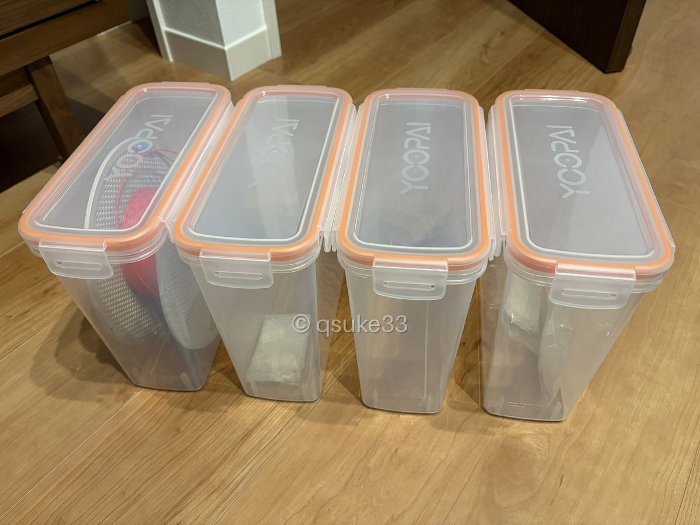

**Bambu Lab A1 mini を使っていて、使っていないフィラメントをどこにしまうか困っていませんか？**

A1 mini にはクローズ型のAMSがないので、私もフィラメントの保管場所を探していました。そこで買ったのが、**YOOPAI（ヨーパイ）のフィラメント収納ボックス 4個セット**です。

## 結論：A1 mini のフィラメント保管はこれで解決

- **フィラメント1巻がピッタリ収まる**
- **ふたの締まりがよい**（パッキン付き・四辺を留め具で閉める）
- **ケースを重ねて置ける**
- **乾燥剤（シリカゲル）付き**で、届いてすぐ使える
- **4個セット**なので、フィラメント4巻をまとめて1巻ずつしまえる



## こんな人におすすめ

- **A1 mini など、クローズ型のAMSがない3Dプリンター**を使っている
- フィラメントが増えてきて、**1巻ずつ分けて保管**したい
- 置き場所が限られていて、**重ねて置ける**ケースがほしい
- 乾燥剤を別に買いそろえる手間をはぶきたい

## なぜフィラメントの保管ケースが必要？

フィラメントは空気中の湿気を吸うと、印刷の仕上がりが悪くなることがあると言われています。そのため、使っていないフィラメントは**乾燥剤と一緒に、ふたを閉めたケースで保管する**のが一般的です。

A1 mini はクローズ型のAMSがなく、フィラメントを閉じた空間に置いておけません。だからこそ、保管用のケースを用意しておくと安心です。

## 商品の基本情報

| 項目 | 内容 |
|---|---|
| メーカー | YOOPAI（ふたにロゴがあります） |
| 個数 | 4個セット |
| 入る量 | 1個にフィラメント1巻 |
| 付属品 | 乾燥剤（シリカゲル） |
| ふた | パッキン付き、四辺を留め具で閉めるタイプ |

※メーカー・個数・付属品は販売ページの記載と手元の現物で確認した内容です。最新の仕様・価格は販売ページで確認してください。

## 実際に使ってわかった4つのよいところ

### 1. フィラメントが1巻ピッタリ収まる

リール1巻がちょうど入ります。大きすぎず小さすぎず、無駄なすき間がほとんどありません。

### 2. ふたの締まりがよい

ふたのまわりにオレンジ色のパッキンが付いていて、四辺の留め具でしっかり閉めるタイプです。実際に使ってみて、**ふたの締まりはよい**と感じています。

### 3. 重ねて置けるから場所をとらない

ケースの上にケースを積み重ねて置けます。横に並べるだけでなく縦にも置けるので、置き場所に合わせやすいです。

### 4. シリカゲルが付いていて、届いてすぐ使える

乾燥剤のシリカゲルが付属していました（上の写真の、下のケースに入っている袋）。別に乾燥剤を買わなくても、届いたその日から使い始められます。

## 気になるところ

今のところ不満はありません。

ただ、まだ使い始めたばかりなので、**長く使ったときの耐久性**（パッキンや留め具がどうなるか）はわかりません。使い続けて気づいたことがあれば、この記事に追記します。

## まとめ：A1 mini ユーザーのフィラメント保管の最初の1セットに

YOOPAI のフィラメント収納ボックス 4個セットは、

- フィラメントが**ピッタリ収まり**
- **ふたの締まりがよく**
- **重ねて置けて**
- **シリカゲル付き**

という、フィラメント保管に必要なものがそろったケースです。

クローズ型のAMSがない **A1 mini** で、フィラメントをどう保管するか迷っているなら、まずはこの4個セットから始めてみてはいかがでしょうか。価格はセールなどで変わることがあるので、販売ページで最新の価格をチェックしてみてください。
