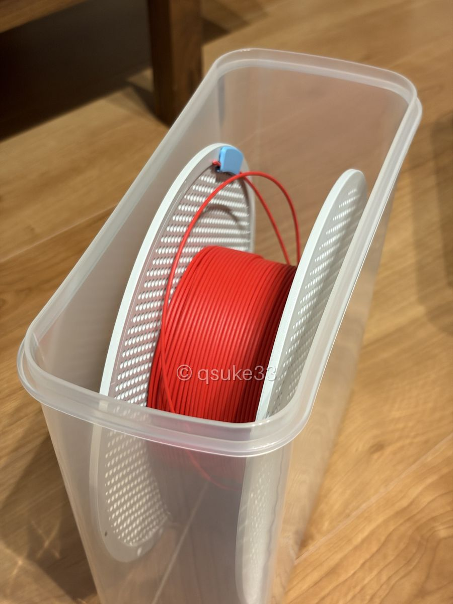
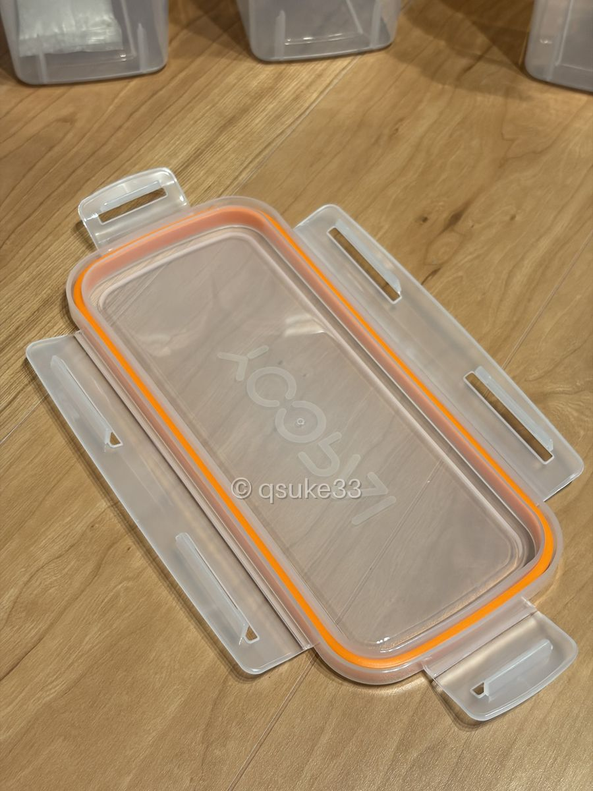
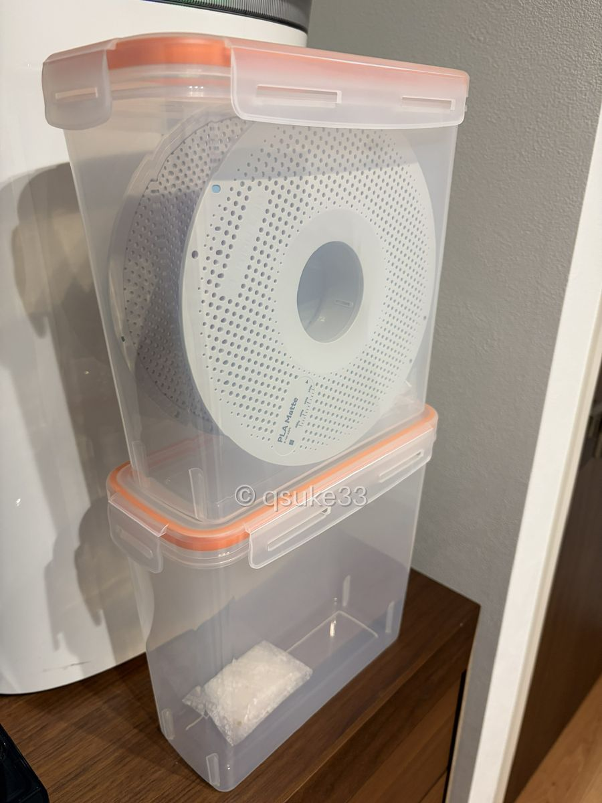

3Dプリンターの **Bambu Lab A1 mini** を使っています。フィラメントを保管するために、**YOOPAI（ヨーパイ）のフィラメント収納ボックス 4個セット**を買いました。

## 商品の基本情報

| 項目 | 内容 |
|---|---|
| メーカー | YOOPAI（ふたにロゴがあります） |
| 個数 | 4個セット |
| 入る量 | 1個にフィラメント1巻 |
| 付属品 | 乾燥剤（シリカゲル） |
| ふた | パッキン付き、四辺を留め具で閉めるタイプ |

※メーカー・個数・付属品は販売ページの記載と手元の現物で確認した内容です。最新の仕様・価格は販売ページで確認してください。

## 買った理由

A1 mini には、フィラメントを閉じた空間で保管できるクローズ型のAMSがありません。そこで、使っていないフィラメントをしまっておくケースを探していました。

## 使ってみてよかったところ

### フィラメントがピッタリ収まる

リール1巻がちょうど入ります。

### ふたの締まりがよい

ふたのまわりにオレンジ色のパッキンが付いていて、四辺の留め具で閉めるタイプです。ふたの締まりはよいです。

### 上に重ねて置ける

ケースの上にケースを積み重ねて置けます。

### シリカゲルが付いていた

乾燥剤のシリカゲルが付属していました（上の写真の、下のケースに入っている袋）。

## 気になるところ

今のところ不満はありません。長く使ったときの耐久性（パッキンや留め具がどうなるか）はまだわからないので、使い続けてわかったことがあれば追記します。

## まとめ

- フィラメントがピッタリ収まる
- ふたの締まりがよい
- 重ねて置ける
- シリカゲル付き

A1 mini のように、クローズ型のAMSがない3Dプリンターでフィラメントの保管場所に困っている人の参考になればうれしいです。
