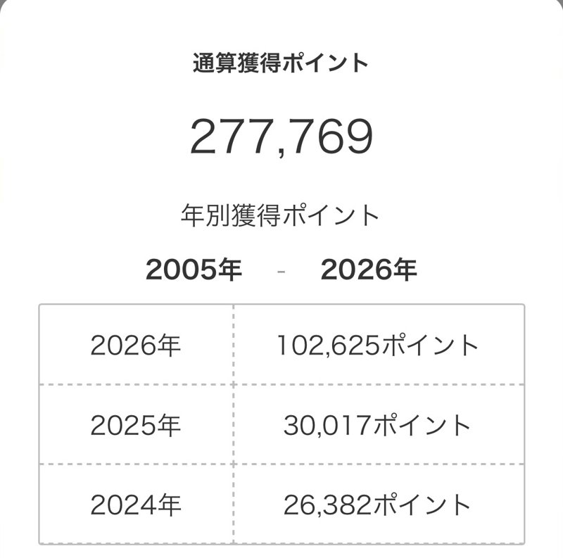

年収400万円台のまま[資産4,000万円になった]({{ '/posts/2026/11/27/shisan-4000man/' | relative_url }})、地方の零細企業勤めの会社員です。

日用品から家電まで、買い物はできるだけ楽天でしています。この記事では、**私が実際に使っている楽天経済圏の組み方**と、2026年11月時点の**SPU・お買い物マラソンのルール**をまとめます。

## 私の楽天ポイントの実績

楽天PointClub「年別獲得ポイント」の画面（2026年11月時点）

| 年 | 獲得ポイント |
|---|---|
| 2024年 | 26,382ポイント |
| 2025年 | 30,017ポイント |
| 2026年（11月まで） | **102,625ポイント** |
| 通算（2005年〜） | 277,769ポイント |

2026年に3倍以上に増えたのは、**楽天ひかりへの乗り換え**と、**妻に楽天モバイルを紹介した**ことが大きいです。どちらもキャンペーンでまとまったポイントがもらえました。くわしくは「[楽天モバイル・楽天ひかり・株主優待で通信費をおトクにする方法]({{ '/posts/2026/11/28/rakuten-tsushinhi/' | relative_url }})」にまとめています。

## 使っている楽天のサービスは5つだけ

| サービス | SPU |
|---|---|
| 楽天モバイル | +4倍 |
| 楽天ひかり（2026年に乗り換え） | +2倍 |
| 楽天カード | +2倍（通常分+1倍、特典分+1倍） |
| 楽天銀行 | 最大+0.5倍（カードの引き落としで+0.3倍、給与などの受け取りで+0.2倍） |
| 楽天証券 | +0.5倍（月3万円以上のポイント投資） |

これで、楽天市場での買い物は**普段9倍前後**になります。

スマホと光回線は、どうせ毎月払う固定費です（[楽天モバイルにするといくら安くなるか計算する]({{ '/rakuten-mobile/' | relative_url }})）。それを楽天にまとめるだけで、SPUの大きな部分（+6倍）が埋まります。逆に、旅行・ファッション・美容など、**ふだん使わないサービスをSPUのためだけに使うことはしていません**。

## 大きな買い物は「お買い物マラソン」と「5と0のつく日」にまとめる

普段の倍率に上乗せできるキャンペーンが2つあります。私は**金額の大きな商品を買うとき**に、これを狙います。

- **お買い物マラソン（ショップ買いまわり）**：期間中に1,000円以上買ったショップの数に応じて、最大10倍まで上がります（要エントリー）。
- **5と0のつく日**：毎月5日・10日・15日・20日・25日・30日。エントリーして楽天カードで払うと、ポイントが4倍（楽天カードの特典を含む。上乗せ分の上限は1,000ポイント）になります。エントリーは開催日ごとに毎回必要です。

<!-- TODO: 一番お得だった買い物の例（本人から後日） -->

## ポイントの使い道：ガソリンや普段の買い物に

貯まったポイントは、**ガソリン代**や、ふだんの買い物の支払いに使っています。SPUなどでもらえるポイントの多くは**期間限定ポイント**（もらった翌月末まで）なので、使い道を決めておくと失効しません。

## 一番大事なルール：ポイントのために無理な買い物をしない

楽天経済圏で一番の落とし穴は、**ポイント目当てで要らない物を買ってしまうこと**です。

- 買いまわりのショップ数を増やすために、要らない物を買わない
- 「10倍だから」と、予定になかった物を買わない

ポイントは「どうせ買う物」を安く買うためのおまけです。私が資産を増やせたのは、ポイントよりも**使わないお金を投資に回し続けたこと**のほうがずっと大きいです。

---

## 2026年最新：SPU（スーパーポイントアッププログラム）一覧

楽天の公式ページで確認した、2026年11月時点の内容です。最大18.5倍（通常の1倍を含む）です。

| サービス | 倍率 | 条件（要約） | 月の上限 |
|---|---|---|---|
| 楽天モバイル | +4倍 | 契約＋エントリー | 2,000pt |
| 楽天モバイル キャリア決済 | +2倍 | 月2,000円以上の支払い＋エントリー | 1,000pt |
| Rakuten Turbo／楽天ひかり | +2倍 | 契約＋エントリー | 1,000pt |
| 楽天カード（通常分） | +1倍 | 楽天市場でカード払い | なし |
| 楽天カード（特典分） | +1倍 | 楽天市場でカード払い | 1,000pt（プレミアムは5,000pt） |
| 楽天銀行＋楽天カード | 最大+0.5倍 | 引き落とし口座で+0.3倍、給与・賞与・年金の受け取りで+0.2倍 | 1,000pt |
| 楽天証券（投資信託） | +0.5倍 | 月3万円以上のポイント投資（1ポイント以上使う） | 2,000pt |
| 楽天証券（米国株式） | +0.5倍 | 月3万円以上のポイント投資（円貨決済） | 2,000pt |
| 楽天ウォレット | +0.5倍 | 暗号資産を月3万円以上購入 | 1,000pt |
| 楽天ポイントカード＋ファミリーマート | +0.5倍 | 提示して月3,000円以上 | 500pt |
| 楽天でんき | +0.5倍 | 前月5,500円以上の利用＋カード払い | 1,000pt |
| 楽天トラベル | +1倍 | 月1回5,000円以上の予約と利用 | 1,000pt |
| 楽天ブックス | +0.5倍 | 月1回1注文3,000円以上 | 500pt |
| 楽天Kobo | +0.5倍 | 月1回1注文3,000円以上 | 500pt |
| 楽天ラクマ | +0.5倍 | 月2,000円以上の販売・発送 | 500pt |
| Rakuten Fashionアプリ | +0.5倍 | 月1回1注文5,000円以上 | 1,000pt |
| 楽天ビューティ | +0.5倍 | 月1回3,000円以上 | 500pt |
| Rakuten Pasha | +0.5倍 | アイテムクーポンで月500pt以上 | 1,000pt |
| 楽天Kドリームス | +0.5倍 | 月1万円以上の投票 | 2,000pt |

**知っておきたいポイント**
- エントリーが必要なのは、楽天モバイル・楽天モバイル キャリア決済・Rakuten Turbo／楽天ひかりの3つだけです（一度エントリーすれば続きます）。
- ポイントの対象は**税抜の金額**です。
- サービスごとに**月の上限**があります。上限を超えた分は、SPUの上乗せが付きません。
- SPUでもらえるポイントの多くは**期間限定ポイント**で、もらった翌月末までに使う必要があります。
- 条件は何度も変わっています（2026年7月にもファミリーマートの追加などの変更がありました）。最新の条件は[楽天市場のSPUページ](https://event.rakuten.co.jp/campaign/point-up/everyday/point/)で確認してください。

## お買い物マラソンのルール

- 期間中に**1,000円（税込）以上**買ったショップの数だけ倍率が上がり、**10ショップで最大10倍**（通常1倍＋特典9倍）です。
- 同じショップで何回買っても1ショップです。
- **エントリーが必要**です。期間中にエントリーすれば、エントリー前の買い物も対象になります。
- 特典ポイントには**上限**があり、回によって7,000ポイントや10,000ポイントなどと変わります。上限は毎回、公式ページで確認してください。
- SPUとは別に計算されるので、両方もらえます。

詳しくは[楽天市場のお買い物マラソンのガイド](https://event.rakuten.co.jp/campaign/point-up/marathon/guide/)にあります。

## まとめ

- 楽天経済圏は、**固定費（スマホ・光回線）とカード・銀行・証券**をまとめるだけで、SPUの大部分が埋まります。
- 大きな買い物は**お買い物マラソンや5と0のつく日**に合わせます。
- **ポイントのために無理な買い物をしない**。これが一番大事です。

浮いたお金を投資に回すなら、まず自分の手取りと、いくら回せるかを把握するところからです。

- [手取り計算シミュレーター]({{ '/tools/tedori/' | relative_url }})
- [ふるさと納税 控除上限額シミュレーター]({{ '/tools/furusato/' | relative_url }})
- [iDeCo 節税シミュレーター]({{ '/tools/ideco/' | relative_url }})
